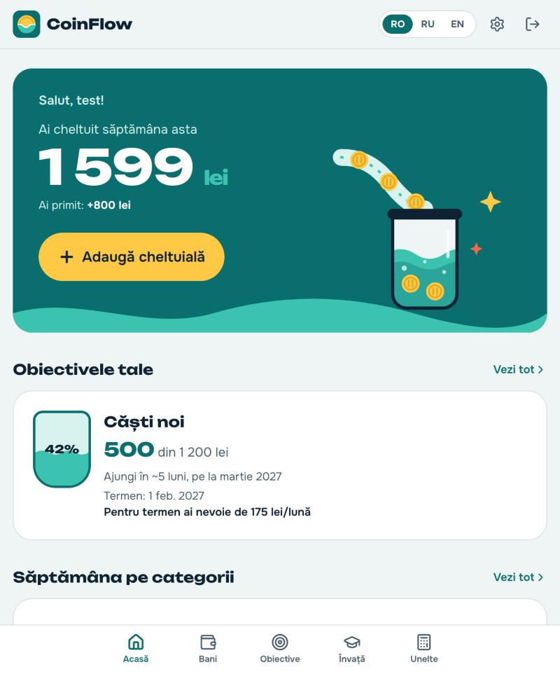
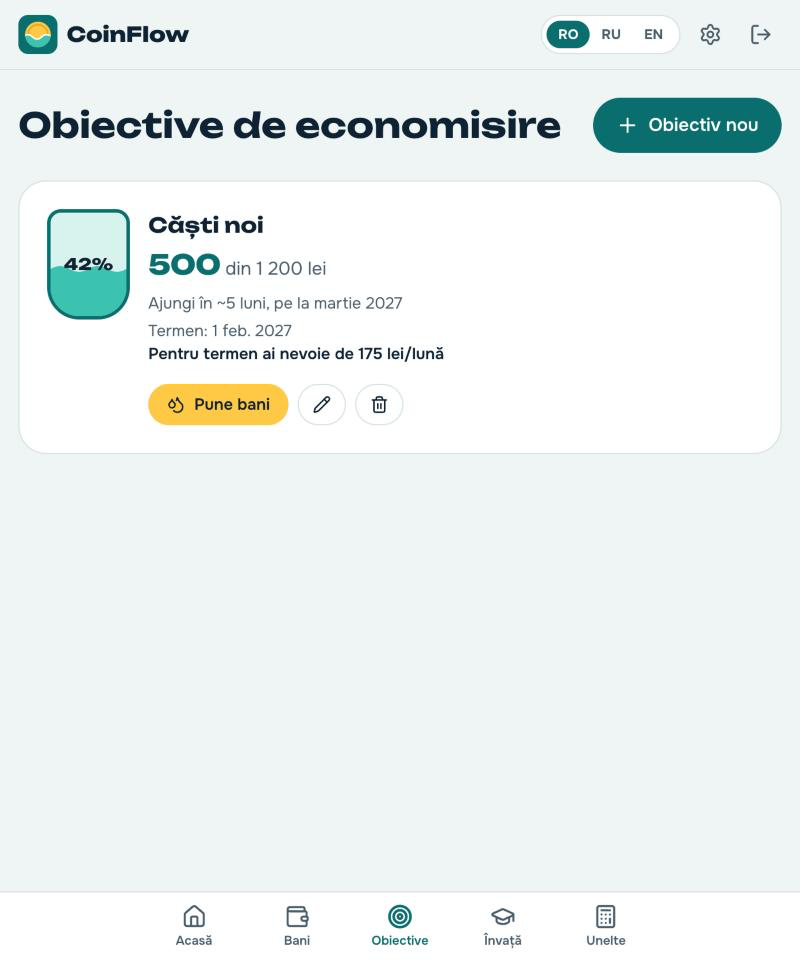
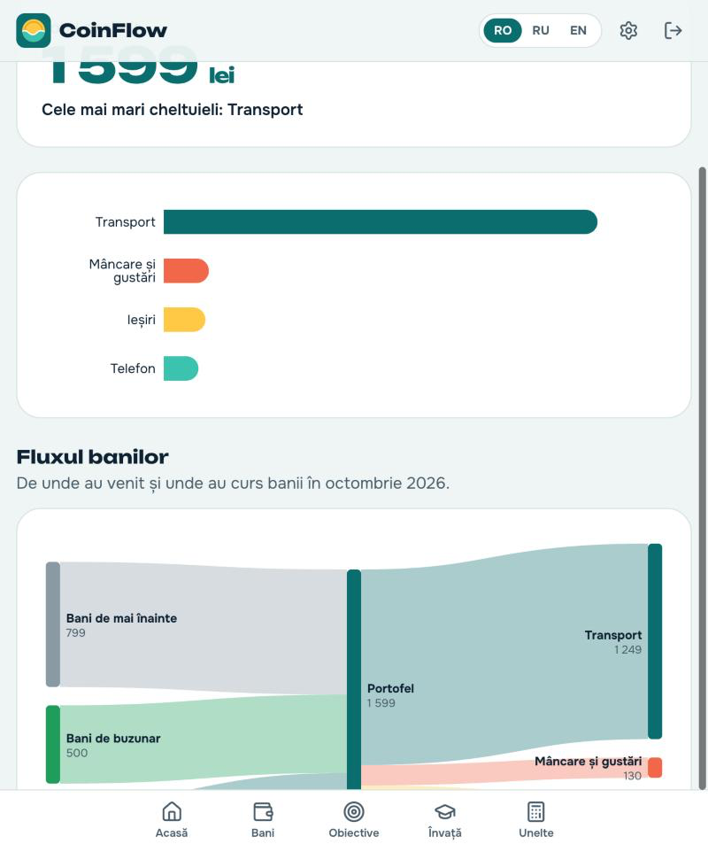
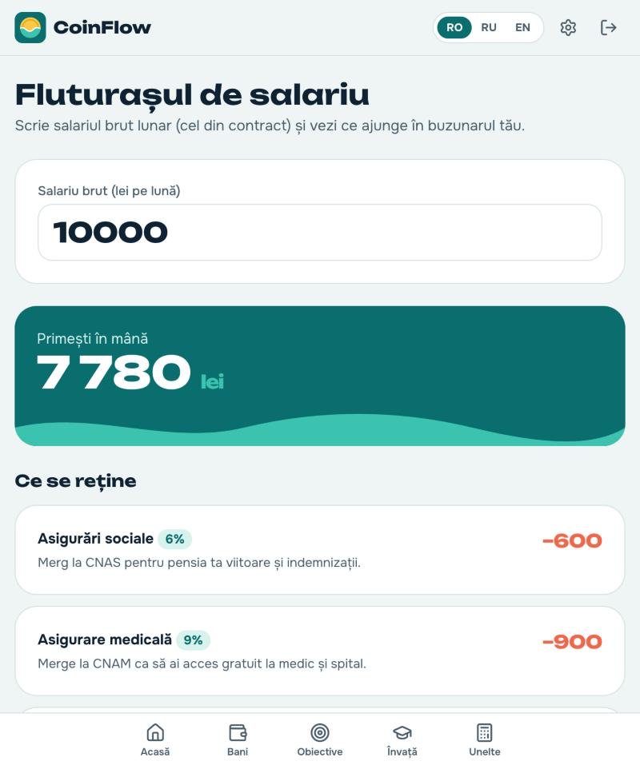
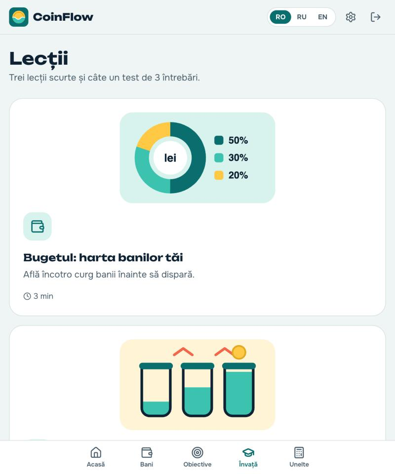
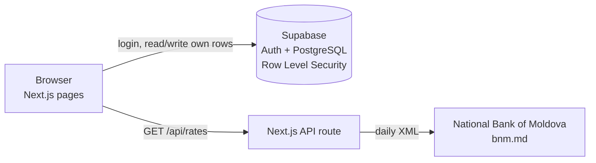
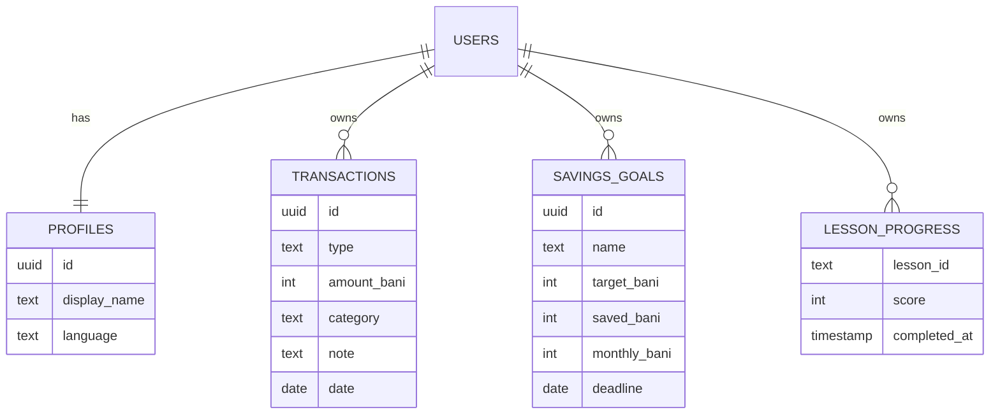

# CoinFlow

**Personal finance for teenagers in Moldova.** Money flows like water: see where it goes, and fill your savings goals like containers.

A school project, built with Next.js and Supabase. Free to use, no ads, no AI inside the app. Available in Romanian, Russian and English.



## The problem

Most teenagers in Moldova get pocket money or earn their first lei from summer jobs, but school rarely teaches how to manage it. Small daily spending disappears without being noticed, saving feels impossible, a first payslip is confusing, and online money scams target young people. Existing budgeting apps are made for adults, are often in English only and don't know Moldovan taxes or the leu.

CoinFlow is made for this age group: simple, visual, in the three languages spoken in Moldova, and built around local details such as MDL, the National Bank of Moldova's exchange rates and Moldovan payroll taxes.

**UN Sustainable Development Goals:** Goal 4, Quality Education (money skills that school rarely teaches) and Goal 1, No Poverty (good habits early help young people avoid debt and scams).

## Features

| | Feature | What you can do |
|---|---|---|
| 1 | Account | Sign up, log in, log out. Each person only sees their own data. |
| 2 | Money | Add income and expenses in two taps (amount + category). Edit and delete. |
| 3 | Home | This week's spending in big numbers, savings goals, recent activity, "add expense" button. |
| 4 | Weekly summary | Bar chart of spending by category; go back week by week. |
| 5 | Money flow | A diagram where income streams into your wallet and out into categories (or stays "left over"). |
| 6 | Savings goals | Name, target, optional deadline. Each goal is a jar that fills up, with an estimate of when you'll reach it and how much per month you need for the deadline. |
| 7 | What if... | Slider for a daily habit (e.g. 35 lei coffee): what it costs per month, year and 5 years. |
| 8 | Payslip explainer | Type a gross salary, see the net salary and each tax explained in simple words. |
| 9 | Currency converter | MDL ⇄ EUR, USD, RON, UAH at the National Bank of Moldova's official rate of the day. Shows "sample rates" if the bank can't be reached. |
| 10 | Lessons | Budgeting, saving and spotting scams, each with a 3-question quiz. Finished lessons are saved. |
| 11 | Settings | Change language (saved to your profile), log out, delete all your data. |

<p>
  
  
</p>
<p>
  
  
</p>

## How to run it

You need [Node.js](https://nodejs.org) 20+ and a free [Supabase](https://supabase.com) project.

1. In Supabase: **Authentication → Sign In / Providers → Email**, turn off **Confirm email**.
2. In the Supabase **SQL Editor**, run the file [`supabase/schema.sql`](supabase/schema.sql).
3. Create `.env.local` in the project folder (values from **Project Settings → Data API / API Keys**):
   ```
   NEXT_PUBLIC_SUPABASE_URL=https://your-project.supabase.co
   NEXT_PUBLIC_SUPABASE_ANON_KEY=your-anon-or-publishable-key
   ```
4. Install and start:
   ```bash
   npm install
   npm run dev
   ```
5. Open http://localhost:3000

| Command | What it does |
|---|---|
| `npm run dev` | Start the app for development |
| `npm test` | Run the 25 unit tests |
| `npm run lint` | Check the code style |
| `npm run build` | Build the app for production |

To put it online, import the GitHub repository on [Vercel](https://vercel.com) and add the two environment variables.

## How it works



- **Pages** (`src/app/`) run in the browser and talk to Supabase directly with the public key.
- **Security** comes from Row Level Security in the database: every table has a rule `auth.uid() = user_id`, so even with the public key a user can only read and change their own rows.
- **Exchange rates** are fetched on the server by an API route (`src/app/api/rates/route.ts`), because the bank's site can't be called from the browser. If it fails, the app falls back to sample rates and says so.
- **Money is stored in bani** (whole numbers, 1 leu = 100 bani) so there are no rounding errors like `0.1 + 0.2 = 0.30000000000000004`.
- **Calculations** (goal estimate, what-if, payslip, conversion, money flow) are plain functions in `src/lib/`, separate from the UI, so they can be unit-tested.
- **Translations** are three JSON files (`src/i18n/ro.json`, `ru.json`, `en.json`) and a small `t("key")` function.

### Database



A database trigger creates the profile automatically when someone signs up.

### Project structure

```
src/app/              pages: home, transactions, summary, goals, what-if, payslip, converter, lessons, settings, login
src/app/api/rates/    API route for the BNM exchange rates
src/components/       shared UI: header, dialogs, goal jar, charts, forms
src/lib/              money helpers, calculations, money flow, BNM parser (+ tests)
src/config/           moldova-tax.ts — payroll tax rates in one place
src/content/          lesson texts and quizzes in 3 languages
src/i18n/             translation files and the language switcher
public/illustrations/ SVG drawings
supabase/schema.sql   tables, security rules, sign-up trigger
docs/                 how it works, presentation notes, screenshots
public/poster.html    printable stand poster with QR code
```

## Quality

- **Tests:** 25 Vitest unit tests for every money calculation (`src/lib/*.test.ts`).
- **CI:** GitHub Actions runs lint, tests and a production build on every push (`.github/workflows/ci.yml`).
- **Accessibility:** keyboard focus ring, "skip to content" link, labelled form fields, dialogs close with Escape, works on phones (bottom navigation) and computers.
- **Privacy:** no tracking, no ads, no third-party scripts. Data is only in the user's own Supabase rows and can be deleted from Settings.

## Things to know

- Tax rates in `src/config/moldova-tax.ts` are for learning only and must be checked against official sources (sfs.md, legis.md).
- The what-if simulator counts 30 days per month and 365 per year.

## Tech and credits

| | Used for | Licence |
|---|---|---|
| [Next.js](https://nextjs.org) + React + TypeScript | App framework | MIT |
| [Tailwind CSS](https://tailwindcss.com) | Styling | MIT |
| [Supabase](https://supabase.com) | Database and login (free plan) | Apache 2.0 (client) |
| [Recharts](https://recharts.org) | Bar chart and money flow diagram | MIT |
| [Lucide](https://lucide.dev) | Icons | ISC |
| [Vitest](https://vitest.dev) | Unit tests | MIT |
| [Unbounded](https://fonts.google.com/specimen/Unbounded), [Onest](https://fonts.google.com/specimen/Onest) | Fonts (Google Fonts) | SIL Open Font License |
| [National Bank of Moldova](https://www.bnm.md) | Official exchange rates | Public data |

The logo and illustrations were drawn for this project as SVG code. How AI tools were used is documented in [AI_LOG.md](AI_LOG.md).
